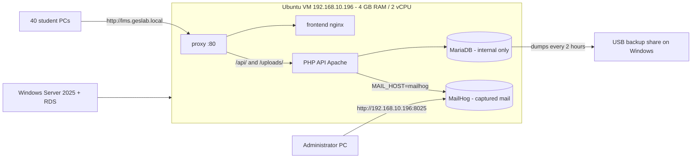

# Learning LMS — Complete Deployment Runbook (GESLAB)

**Target:** Windows Server 2025 (32 GB RAM, 1 TB SSD, i7-12700, also the RDS host for 40 students) → Hyper-V → Ubuntu Server 24.04 VM (`192.168.10.196`) → Docker Engine → Learning LMS.

**Student address:** `http://lms.geslab.local` (port 80 — no port number typed).

---

## 0. READ THIS FIRST

### What you already have
- Ubuntu Server ISO (you downloaded it).
- A file called `docker.exe`. **This is Docker Desktop for Windows. DO NOT INSTALL IT.**

### Why not Docker Desktop
Docker Desktop is not supported on Windows Server and is not needed. Your LMS images are **Linux** images. They run on **Docker Engine inside the Ubuntu VM**. Installing Docker Desktop on the Windows host wastes resources and can interfere with RDS and Hyper-V. Leave `docker.exe` unused.

### What this folder contains
Everything you need, organised into:

| Folder | Contents |
| --- | --- |
| `windows/` | PowerShell scripts for the Windows Server host |
| `ubuntu/` | Shell scripts and config files to run inside the Ubuntu VM |
| `database/init-production/` | Clean database initialisation files (no demo accounts) |
| `compose/` | `docker-compose.production.yml` |
| `docs/` | Power-cut protection, troubleshooting, final checklist |
| `01-FOLDER-GUIDE.md` | What each file is and when to use it |

### Placeholders you must fill in
Search this runbook and the files for these. Replace every occurrence before running.

| Placeholder | Meaning | How to find it |
| --- | --- | --- |
| `WINDOWS_IP` | Windows Server LAN IP | Phase 0, step 1 |
| `GATEWAY_IP` | Your router IP | Phase 0, step 1 |
| `USB_DRIVE` | External USB drive letter (example `E:`) | Phase 0, step 3 |
| `ADMIN_EMAIL` | Your real super-admin email | You choose |
| `BACKUP_PASSWORD` | Strong password for the backup account | You choose |
| `ISO_PATH` | Full path to the Ubuntu ISO | Phase 3, step 1 |

The LMS name `lms.geslab.local` is already written into all files. Do not change it unless you also update DNS and the frontend image.

### Architecture



---

## PHASE 0 — Discover your network (do this at school, before anything else)

You said you do not know the IP/gateway yet. Run these in **Administrator PowerShell** on the Windows Server and write the answers down.

```powershell
# 1. Windows Server LAN IP, gateway, DNS
Get-NetIPConfiguration |
  Select-Object InterfaceAlias, IPv4Address, IPv4Gateway, DNSServer

# Shorter alternative:
ipconfig
```
Write down:
- `WINDOWS_IP` = the IPv4 address of the LAN adapter (example `192.168.10.10`). It is **not** `127.0.0.1` and not `169.254.x.x`.
- `GATEWAY_IP` = the Default Gateway (example `192.168.10.1`).

```powershell
# 2. Disk space and RAM
Get-Volume -DriveLetter C |
  Select-Object DriveLetter, @{N='Total_GB';E={[math]::Round($_.Size/1GB,2)}},
                             @{N='Free_GB';E={[math]::Round($_.SizeRemaining/1GB,2)}}
Get-CimInstance Win32_ComputerSystem |
  Select-Object @{N='RAM_GB';E={[math]::Round($_.TotalPhysicalMemory/1GB,2)}}
```

```powershell
# 3. Find the USB drive letter after you plug in the external drive
Get-Volume | Where-Object { $_.DriveType -eq 'Removable' -or $_.FileSystemLabel } |
  Select-Object DriveLetter, FileSystemLabel, DriveType,
                @{N='Free_GB';E={[math]::Round($_.SizeRemaining/1GB,2)}}
```
Write down `USB_DRIVE` (example `E:`).

```powershell
# 4. Current RDS sessions (should be about 40 during teaching)
quser
```

```powershell
# 5. Where is your Ubuntu ISO?
Get-ChildItem -Path C:\ -Filter '*ubuntu*24*.iso' -Recurse -ErrorAction SilentlyContinue |
  Select-Object FullName, Length
```
Write down `ISO_PATH`. If nothing is found, copy the ISO to `C:\ISO\ubuntu-24.04-live-server-amd64.iso` and use that as `ISO_PATH`.

---

## PHASE 1 — Capacity gate (DO NOT SKIP)

This server also runs RDS for 40 students. The 4 GB VM must be earned.

1. Copy `windows/Monitor-RDS.ps1` to `C:\Learning-Deployment\windows\`.
2. Run it in **Administrator PowerShell** during a normal busy teaching period, with all 40 students working, and leave it for 60 minutes:

```powershell
Set-ExecutionPolicy -Scope Process Bypass
C:\Learning-Deployment\windows\Monitor-RDS.ps1
```

3. Read the summary at the end:

| Measurement | Safe to continue |
| --- | --- |
| `Min_Available_GB` | **8 GB or more** |
| `Max_CPU_Pct` | **below 80** |
| `P95_Read_Latency_ms` | **below 20** |

- **All three pass** → continue to Phase 2.
- **Any fails** → stop. Reduce the VM to 2 GB and accept reduced capacity, or use a separate machine for Docker. Do not take memory away from the students.

The script is read-only: it only reads counters and writes a CSV to `C:\ServerMonitoring\`. It never stops a service or kills a process.

---

## PHASE 2 — Prepare Windows Server

### Step 1 — Install Hyper-V (maintenance window; it reboots and disconnects students)

```powershell
Install-WindowsFeature -Name Hyper-V -IncludeManagementTools -Restart
```
After reboot:
```powershell
Get-WindowsFeature Hyper-V | Select-Object Name, InstallState
Get-Service vmms | Select-Object Name, Status
```

### Step 2 — Create folders

```powershell
New-Item -ItemType Directory -Force -Path C:\Learning-Deployment, C:\HyperV\LearningDocker, C:\ServerMonitoring | Out-Null
```
Copy the **entire** `learning-deployment` folder contents into `C:\Learning-Deployment\` on the server.

### Step 3 — Create the external virtual switch

In **Hyper-V Manager → Virtual Switch Manager → New virtual network switch → External**:
- Name: `Docker-External`
- Select the physical LAN adapter (the one with `WINDOWS_IP`).
- Keep **"Allow management operating system to share this network adapter"** checked.
- Apply.

Expect a brief network interruption. Do this when students are not connected.

### Step 4 — Configure DNS for `lms.geslab.local`

Run `windows/Configure-DNS.ps1` as Administrator. It will:
- install the DNS role if missing,
- create the forward zone `geslab.local`,
- add the A record `lms` → `192.168.10.196`,
- verify with `Resolve-DnsName lms.geslab.local`.

```powershell
Set-ExecutionPolicy -Scope Process Bypass
C:\Learning-Deployment\windows\Configure-DNS.ps1
```

**Then make the 40 student PCs use this server as DNS.** If your router handles DHCP, set its DNS server option to `WINDOWS_IP`. If the Windows Server handles DHCP, set scope option 006 to `WINDOWS_IP`. If neither is possible, use `docs/TROUBLESHOOTING.md` → "DNS fallback with hosts file".

Verify from a **student PC**:
```
nslookup lms.geslab.local
```
It must return `192.168.10.196`. Do not continue until this works.

---

## PHASE 3 — Create the Ubuntu VM

### Step 1 — Edit the VM script

Open `windows/Create-LearningDockerVM.ps1` and set:

```powershell
$ISOPath = 'ISO_PATH'          # from Phase 0 step 5
$SwitchName = 'Docker-External'
```

Do not change the RAM (4 GB), CPU (2), or disk (80 GB) unless Phase 1 told you to.

### Step 2 — Run the readiness check and creation script

```powershell
Set-ExecutionPolicy -Scope Process Bypass
C:\Learning-Deployment\windows\Check-ProductionReadiness.ps1
C:\Learning-Deployment\windows\Create-LearningDockerVM.ps1
```

The creation script refuses to run if RAM is under 32 GB or if the ISO/switch is missing. It sets automatic start (60-second delay) and automatic stop = **Shut Down**.

### Step 3 — Install Ubuntu 24.04

In **Hyper-V Manager**, connect to the VM and start the installer:

- Language/keyboard: your choice.
- Installation type: **Ubuntu Server** (not desktop).
- Network: it should get an address by DHCP. Note the MAC address shown.
- Hostname: `learning-docker`
- Create a dedicated administrator account (not `root`; you will use `sudo`).
- **Install OpenSSH Server** (tick it in the installer).
- Do not install extra snaps you do not need.
- Finish, reboot.

### Step 4 — Reserve the IP address

In your router/DHCP server, create a reservation:
- MAC address = the VM's MAC from step 3
- IP address = `192.168.10.196`
- Hostname = `learning-docker`

If you cannot create a reservation, see `docs/TROUBLESHOOTING.md` → "Static IP inside Ubuntu".

### Step 5 — Detach the ISO and verify

In Hyper-V Manager → VM Settings → SCSI Controller → DVD Drive → Remove. Then set the virtual disk as first boot device (the creation script already did this, but the installer may have changed it).

From the VM console:
```bash
hostnamectl
ip -4 addr
ping -c 4 GATEWAY_IP
```

---

## PHASE 4 — Install Docker Engine inside Ubuntu

Connect over SSH from another computer (or use the VM console):

```bash
ssh <your-ubuntu-user>@192.168.10.196
```

Copy `ubuntu/setup-docker.sh` into the VM (for example with `scp` or by pasting its contents), then:

```bash
chmod +x setup-docker.sh
sudo ./setup-docker.sh
```

The script installs Docker from Docker's official repository, configures log rotation and `live-restore`, installs `cifs-utils`, and enables Docker at boot. Verify:

```bash
docker --version
docker compose version
sudo systemctl is-enabled docker
sudo docker run hello-world
```

---

## PHASE 5 — Deploy the LMS stack

### Step 1 — Copy the deployment files to the VM

On the Windows machine (PowerShell):

```powershell
scp -r C:\Learning-Deployment\ubuntu\* <ubuntu-user>@192.168.10.196:/home/<ubuntu-user>/learning-deployment/
scp -r C:\Learning-Deployment\database <ubuntu-user>@192.168.10.196:/home/<ubuntu-user>/learning-deployment/
scp -r C:\Learning-Deployment\compose <ubuntu-user>@192.168.10.196:/home/<ubuntu-user>/learning-deployment/
```

If `scp` is not available on Windows, use WinSCP or paste the file contents with `nano` inside the VM.

### Step 2 — Build the directory structure inside the VM

```bash
sudo mkdir -p /opt/learning/{proxy,database/config,db/init.production,lms-api,backups}
sudo chown -R "$USER":"$USER" /opt/learning
cd /home/$USER/learning-deployment

sudo cp compose/docker-compose.production.yml /opt/learning/docker-compose.yml
sudo cp ubuntu/proxy-nginx.conf /opt/learning/proxy/nginx.conf
sudo cp ubuntu/maria-production.cnf /opt/learning/database/config/99-production.cnf
sudo cp ubuntu/backup.sh ubuntu/restore.sh ubuntu/check-health.sh /opt/learning/
sudo cp ubuntu/*.example /opt/learning/
sudo cp database/init-production/*.sql /opt/learning/db/init.production/
```

Copy the schema and remaining init files from the Learning repository (`01-lms.sql`, `03-refresh-tokens.sql`, `04-quiz-submission-questions.sql`, `05-question-bank.sql`, `06-question-bank-metadata.sql`) into `/opt/learning/db/init.production/`.

> These files live in the Learning Git repo under `db/init/`. Copy them from your local repo, not from the internet.

Copy the application source into `/opt/learning/lms-api` and `/opt/learning/lms-frontend` (the two folders from the repo). The Compose file builds both images from source.

> **About demo / test logins:** the repo's `lms-frontend/assets/js/env.js` contains `APP_ENV='development'`, `API_BASE_URL=http://localhost:8000`, and demo credentials for local testing. **This is safe for production:** the frontend `Dockerfile` overwrites `env.js` during the image build using the `APP_ENV=production` and `API_BASE_URL` build arguments from the Compose file. The production image therefore has `APP_ENV=production`, the correct `http://lms.geslab.local` API URL, and **no demo credentials**. The login page's quick-login buttons are also commented out in `login.html` and are gated on `APP_ENV === 'development'`. Do not skip `docker compose up -d --build` — a plain `up -d` would not regenerate the image with the production values.

### Step 3 — Create the environment files

Generate secrets first:

```bash
openssl rand -hex 32   # database root password
openssl rand -hex 32   # database app password
openssl rand -hex 32   # JWT secret
```

Create `/opt/learning/.env.docker` from `ubuntu/production.env.example`. It needs **both** sets of names — `MYSQL_*` is what the MariaDB image reads, `DB_*` is kept in sync with the API file:

```ini
MYSQL_ROOT_PASSWORD=<paste first secret>
MYSQL_DATABASE=lms
MYSQL_USER=lms_user
MYSQL_PASSWORD=<paste second secret>

DB_ROOT_PASSWORD=<paste first secret>
DB_NAME=lms
DB_USER=lms_user
DB_PASS=<paste second secret>

API_BASE_URL=http://lms.geslab.local
```

Create `/opt/learning/lms-api/.env.docker` from `ubuntu/api-production.env.example`. The critical lines:

```ini
DB_HOST=db
DB_PORT=3306
DB_NAME=lms
DB_USER=lms_user
DB_PASS=<same second secret>
APP_ENV=production
APP_DEBUG=false
APP_URL=http://lms.geslab.local
FRONTEND_URL=http://lms.geslab.local
ALLOWED_ORIGINS=http://lms.geslab.local
JWT_SECRET=<paste third secret; at least 32 characters>

# MailHog stays in the stack. This is the default because the school has no internet.
MAIL_HOST=mailhog
MAIL_PORT=1025
MAIL_USERNAME=
MAIL_PASSWORD=
MAIL_FROM_ADDRESS=noreply@lms.geslab.local
MAIL_FROM_NAME="LMS System"
```

**`ALLOWED_ORIGINS` must contain `http://lms.geslab.local` exactly** — the API's automatic LAN-origin detection matches IP ranges such as `192.168.x`, not a `.local` hostname.

**Mail choice is yours.** MailHog is **not removed** from the production stack. With the values above, every LMS email is captured locally and can be read at `http://192.168.10.196:8025`. If you later get internet and want real SMTP, change `MAIL_HOST`, `MAIL_PORT`, `MAIL_USERNAME` and `MAIL_PASSWORD` to your provider's values and run:

```bash
cd /opt/learning && docker compose up -d --force-recreate api
```

MailHog can keep running; it will simply receive nothing. This lets you switch back and forth by changing only the env file.

Protect both files:

```bash
chmod 600 /opt/learning/.env.docker /opt/learning/lms-api/.env.docker
```

Never commit these files or paste them into chat.

### Step 4 — Validate, then start

```bash
cd /opt/learning
docker compose -f docker-compose.yml config
```
This prints the resolved configuration. Read it for errors. Then:

```bash
docker compose -f docker-compose.yml up -d --build
docker compose -f docker-compose.yml ps
```

Expected: `db` healthy, `api`, `frontend`, `proxy`, and `mailhog` running. The **proxy** publishes port `80` to the LAN for students. **MailHog publishes port `8025`** for you to read captured email. MariaDB and SMTP port 1025 have no published ports.

### Step 5 — Verify

```bash
# API is alive (401 is the expected answer)
curl -i http://127.0.0.1:8081/api/auth/me

# Through the proxy (also 401)
curl -i http://127.0.0.1/api/auth/me

# Frontend page
curl -I http://127.0.0.1/

# MailHog UI (should return 200)
curl -I http://127.0.0.1:8025/

# Container resource usage
docker stats --no-stream

# Logs
docker compose logs --tail=100
```

Then from a **student PC**, open `http://lms.geslab.local`. You should see the login page.

---

## PHASE 6 — First-time setup (fresh install)

The production init set deliberately excludes the demo institution, the demo super-admin with the committed password hash, and `allow_registration: 1`. It installs schema, roles/permissions, question-bank tables, and a settings row with public registration **off**.

1. Create the real super admin:

```bash
cd /opt/learning
docker compose exec api php scripts/create_superadmin.php --email=ADMIN_EMAIL
```

The script prints a generated password **once**. Save it in a password manager.

2. Sign in at `http://lms.geslab.local` with that account.
3. Create your institution through the UI, then create the teacher and student accounts.
4. In Settings, confirm **public registration is disabled**.
5. Pilot with 3–5 student PCs before rolling out to all 40.

---

## PHASE 7 — Backups to the external USB drive

### Step 1 — Prepare the USB share on Windows

Plug in the USB drive, confirm `USB_DRIVE` from Phase 0 step 3, then run as Administrator:

```powershell
Set-ExecutionPolicy -Scope Process Bypass
C:\Learning-Deployment\windows\Setup-UsbBackupShare.ps1
```

Edit the script's `$Drive` variable first if your drive is not `E:`. It creates a restricted local account, an NTFS-protected folder, the `LearningBackups$` share, and a firewall rule for the LAN subnet. **Save `BACKUP_PASSWORD` when prompted.**

### Step 2 — Mount the share in Ubuntu

```bash
sudo mkdir -p /mnt/learning-backups
sudo nano /root/.smb-learning
```

Contents:
```
username=LearningBackup
password=BACKUP_PASSWORD
domain=WINDOWS_SERVER_NAME
```
(`WINDOWS_SERVER_NAME` is the device name, e.g. `GESLAB_PRESBYSHSTEMA`.)

```bash
sudo chmod 600 /root/.smb-learning
```

Add to `/etc/fstab` (replace `WINDOWS_IP`):

```
//WINDOWS_IP/LearningBackups$ /mnt/learning-backups cifs credentials=/root/.smb-learning,vers=3.1.1,uid=0,gid=0,file_mode=0600,dir_mode=0700,_netdev,nofail,x-systemd.automount 0 0
```

Then:

```bash
sudo mount -a
df -h /mnt/learning-backups
sudo touch /mnt/learning-backups/test.txt && sudo rm /mnt/learning-backups/test.txt
```

### Step 3 — Schedule backups

```bash
sudo chmod 700 /opt/learning/backup.sh /opt/learning/restore.sh /opt/learning/check-health.sh
sudo /opt/learning/backup.sh          # test it once now
```

Schedule frequent dumps (important with no UPS):

```bash
sudo crontab -e
```

Add:

```cron
# Database + uploads every 2 hours, plus a final copy before the end of the school day
0 */2 * * * /opt/learning/backup.sh >> /var/log/learning-backup.log 2>&1
30 16 * * 1-5 /opt/learning/backup.sh >> /var/log/learning-backup.log 2>&1
```

Adjust `16:30` to the time you normally shut down. A 1 AM job would never run because the server is off at night.

Verify a backup:

```bash
ls -lh /mnt/learning-backups/
sha256sum -c /mnt/learning-backups/<newest>.sha256
```

---

## PHASE 8 — Power-cut protection (no UPS — best effort)

Read `docs/POWER-CUT-PROTECTION.md` in full. Summary of what is configured:

1. **BIOS/UEFI:** set *Restore on AC Power Loss / AC Recovery* to **Power On**. When electricity returns after a cut, the server boots by itself. Without this, someone must press the power button.
2. **Hyper-V:** the VM is set to automatic start (60-second delay) and automatic stop = **Shut Down** for planned Windows shutdowns.
3. **MariaDB:** `maria-production.cnf` sets `innodb_flush_log_at_trx_commit=1`, `innodb_doublewrite=ON`, and `sync_binlog=1` so a sudden power loss does not tear writes.
4. **Backups:** every 2 hours to the USB share, so the worst-case loss is about two hours of work.
5. **Windows:** use **normal Shut Down** when leaving. Never hold the power button or flip a wall switch unless there is no alternative.
6. **Honest limit:** software cannot fully protect against an abrupt power cut. A small UPS with USB monitoring is the only real fix; `docs/POWER-CUT-PROTECTION.md` explains what it would add and what to do after a cut.

---

## PHASE 9 — Prove the automatic startup

Test exactly how you actually operate:

1. Save your work. Run a manual backup:
   ```bash
   sudo /opt/learning/backup.sh
   ```
2. Do a **normal Windows Shut Down** (Start → Power → Shut down). Hyper-V gracefully shuts down the Ubuntu guest; Docker stops the containers in order.
3. Power the server back on. **Nobody logs in.**
4. Wait a few minutes, then check from a student PC:
   - `nslookup lms.geslab.local` → `192.168.10.196`
   - open `http://lms.geslab.local` → login page
   - log in with a teacher and a student account
5. On the Ubuntu VM:
   ```bash
   systemctl is-active docker
   cd /opt/learning && docker compose ps
   ./check-health.sh
   ```

If anything did not come back, work through the order in `docs/TROUBLESHOOTING.md` → "Nothing starts after power on".

---

## PHASE 10 — Go live

1. Pilot with a few students, check exam/grading operations and question-bank actions.
2. Roll out to all 40.
3. Watch `Monitor-RDS.ps1` again during the first full teaching day.
4. Keep the final checklist in `docs/CHECKLIST.md` somewhere safe (print it or save a copy outside the server).

---

## Quick reference commands (Ubuntu VM)

```bash
cd /opt/learning
docker compose ps                       # status
docker compose logs --tail=100 api      # API logs
docker compose restart api              # restart API
docker compose up -d --build            # rebuild after code changes
./backup.sh                             # manual backup
./restore.sh <backup-file.gz>           # restore (stops API first)
./check-health.sh                       # quick health report
df -h                                   # disk space
docker system df                        # Docker disk usage
```

**NEVER run `docker compose down -v`** — it deletes the MariaDB data volume and destroys your LMS data.

---

## Quick reference commands (Windows host)

```powershell
Get-VM Learning-Docker | Select-Object Name, State, CPUUsage, MemoryAssigned
Get-VM -Name Learning-Docker | Select-Object AutomaticStartAction, AutomaticStartDelay, AutomaticStopAction
Resolve-DnsName lms.geslab.local
C:\Learning-Deployment\windows\Monitor-RDS.ps1
```

For anything unexpected, open `docs/TROUBLESHOOTING.md`.
