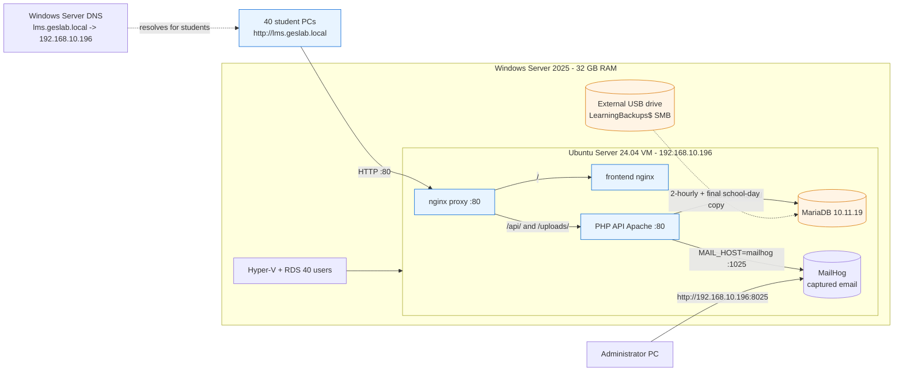

# Learning LMS — production architecture

Students reach the LMS at `http://lms.geslab.local` on port 80. Windows Server DNS resolves that name to the Ubuntu VM's IP. Only the nginx proxy publishes port 80; MailHog's web UI is published on 8025 for administration. MariaDB and SMTP port 1025 stay internal to the Docker network.

## Port exposure

| Port | Service | Reachable from |
| --- | --- | --- |
| 80 | nginx proxy | All 40 student PCs |
| 8025 | MailHog web UI | Administrators only (LAN) |
| 1025 | MailHog SMTP | Internal Docker network only |
| 3306 | MariaDB | Internal Docker network only |
| 8081 / 8082 | API / frontend debug | `127.0.0.1` on the VM only |
